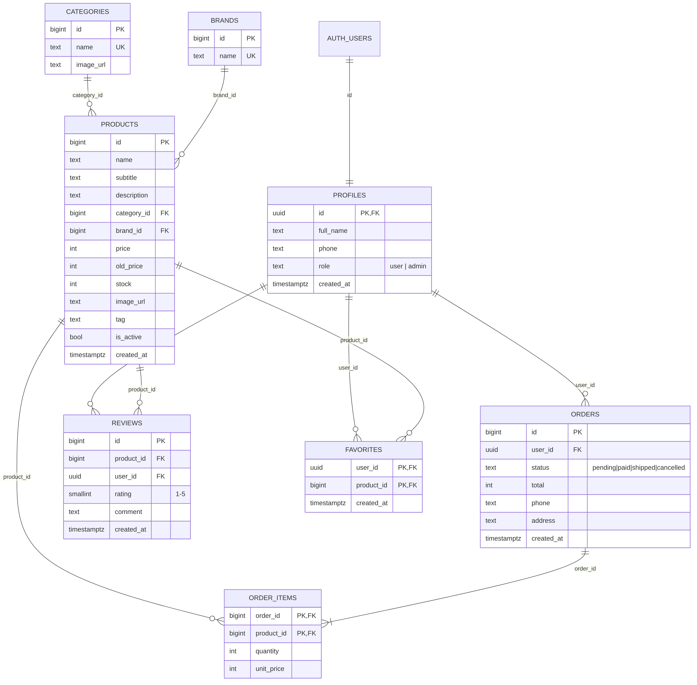
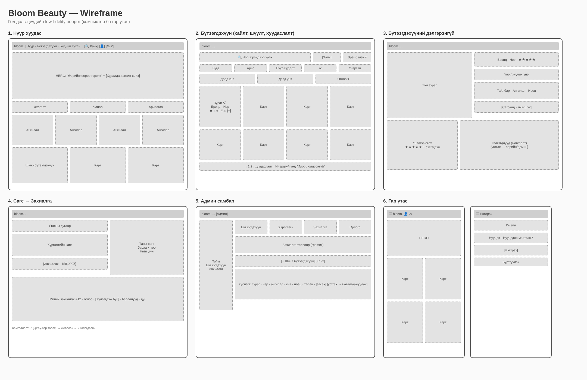

# Bloom Beauty — онлайн гоо сайхны дэлгүүр

React болон Supabase дээр бүтээсэн full-stack онлайн дэлгүүр. SWE334 Интернет програмчлал хичээлийн бие даалтын төсөл.

## Төслийн зорилго
Монголд гоо сайхны бүтээгдэхүүнийг сошиал хуудсаар зарахад үнэ, нөөц тодорхойгүй, харьцуулах боломжгүй, захиалгын явц харагддаггүй. Bloom Beauty нь бүтээгдэхүүнийг хайж, шүүж, харьцуулаад сагсаар захиалж, төлвөө хянах боломжтой онлайн дэлгүүр юм. Дэлгэрэнгүй: [docs/requirements.md](./docs/requirements.md)

## Боломжууд
- **Бүртгэл ба эрх:** бүртгүүлэх, нэвтрэх, гарах, нууц үг сэргээх; хэрэглэгч / админ эрх; хамгаалагдсан хуудсууд (`ProtectedRoute`)
- **Бүтээгдэхүүн:** нэр/брэндээр хайх, ангилал, үнэ, огноогоор шүүх, эрэмбэлэх, хуудаслах; илэрцгүй үеийн мэдэгдэл
- **Сагс ба захиалга:** сагс (localStorage), `create_order()` RPC-ээр захиалга (үнийг сервер тооцоолно, нөөц хасагдана), захиалгын түүх
- **Хүслийн жагсаалт, үнэлгээ:** ♡ хадгалах, 1–5 од, сэтгэгдэл
- **Админ самбар:** статистик, бүтээгдэхүүн CRUD (зураг Supabase Storage-д, урьдчилан харах, 2MB / JPG·PNG·WEBP хязгаар), устгахын өмнө баталгаажуулах, захиалгын төлөв удирдах
- **UI/UX:** Tailwind CSS, responsive, toast мэдэгдэл, ачаалж буй / хоосон / алдааны төлөв

## Технологи
| Технологи | Зориулалт |
|---|---|
| React 18 + Vite | Компонент, state, props |
| React Router 6 | Хуудас хоорондын шилжилт, nested admin route |
| Tailwind CSS 4 | Нэгдсэн дизайн систем (`src/index.css` дахь `@theme`) |
| Supabase Auth / PostgreSQL / Storage | Нэвтрэлт, өгөгдлийн сан, зураг |
| Row Level Security | Бүх 8 хүснэгтэд эрхийн хамгаалалт |
| QPay + Edge Functions | Төлбөр, webhook (Хамгаалалт-2) |
| Vercel | Байршуулалт (Хамгаалалт-2) |

## Өгөгдлийн сан


| Хүснэгт | Зориулалт | Холбоо |
|---|---|---|
| `profiles` | Хэрэглэгч, эрх (`role`) | `auth.users` 1:1 |
| `categories`, `brands` | Ангилал, брэнд | 1:N → `products` |
| `products` | Бүтээгдэхүүн, үнэ, нөөц | |
| `orders` | Захиалга, төлөв | `profiles` 1:N |
| `order_items` | Захиалгын мөр | **N:M** `orders ↔ products` |
| `favorites` | Хүслийн жагсаалт | **N:M** `profiles ↔ products` |
| `reviews` | Үнэлгээ, сэтгэгдэл | `products`, `profiles` 1:N |

**RLS-ийн гол бодлого:** хэрэглэгч зөвхөн өөрийн захиалга, хүслийн жагсаалт, сэтгэгдлээ хардаг/өөрчилдөг; `role`-оо өөрчилж чадахгүй (column-level grant); бүтээгдэхүүн, ангилал, захиалгын төлвийг зөвхөн админ өөрчилнө; захиалгыг зөвхөн `create_order()` функцээр үүсгэнэ.

Бүтэн SQL: [supabase/schema.sql](./supabase/schema.sql) · Жишээ өгөгдөл: [supabase/seed.sql](./supabase/seed.sql) · dbdiagram: [docs/erd.dbml](./docs/erd.dbml)

## Wireframe


## Суулгах заавар
```bash
git clone https://github.com/b22ft1012-hash/beauty-shop.git
cd beauty-shop
npm install
cp .env.example .env      # Supabase URL болон anon (publishable) түлхүүрээ бичнэ
npm run dev               # http://localhost:5173
```

Supabase дээр:
1. SQL Editor-т `supabase/schema.sql`, дараа нь `supabase/seed.sql`-ийг ажиллуулна
2. Бүртгүүлсний дараа өөрийгөө админ болгоно: `update profiles set role = 'admin' where id = (select id from auth.users where email = 'таны@имэйл');`

> `service_role` түлхүүрийг frontend-д хэзээ ч ашиглахгүй. `.env` нь `.gitignore`-д орсон.

## Кодын бүтэц
```
src/
  components/  Header, Footer, Layout, ProductCard, CartDrawer, ProtectedRoute, ConfirmDialog, Pagination, ui
  context/     AuthContext (хэрэглэгч, эрх), CartContext (сагс), ToastContext (мэдэгдэл)
  hooks/       useFavorites
  lib/         supabase.js, format.js
  pages/       Home, Products, ProductDetail, Login, Register, ForgotPassword, ResetPassword,
               Checkout, Orders, Favorites, About, NotFound
  pages/admin/ AdminLayout, AdminDashboard, AdminProducts, ProductForm, AdminOrders
supabase/      schema.sql, seed.sql
docs/          requirements.md, erd.png, erd.dbml, user-flow.png, wireframes.png
```

## Эх сурвалж
Бүтээгдэхүүний зургууд: [Unsplash](https://unsplash.com) (чөлөөт лиценз). Үнэ, нөөц нь demo өгөгдөл.

Э.Намжилмаа · B22FT1012 · СЭЗИС
