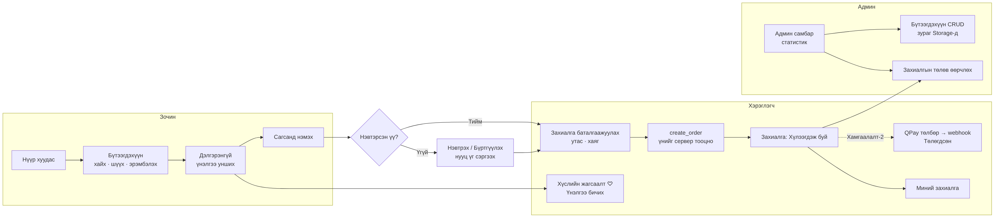
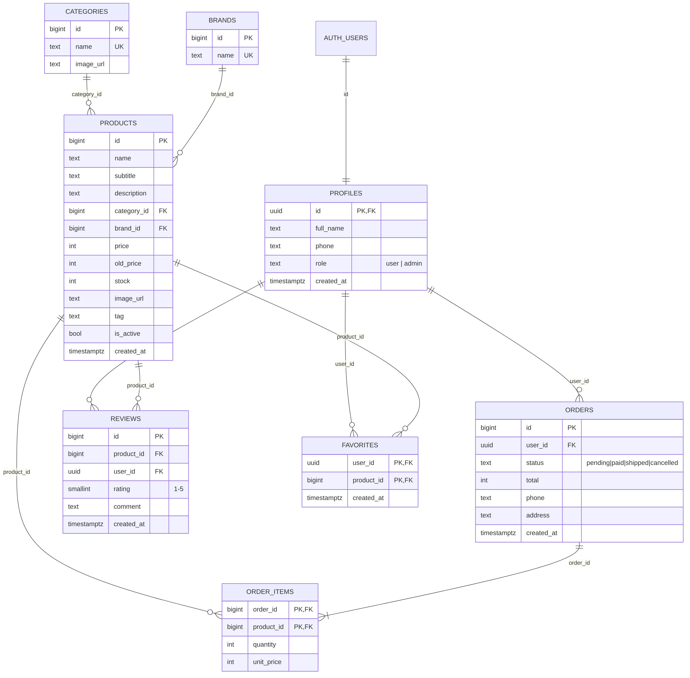

# Bloom Beauty — Шаардлагын баримт

## 1. Асуудал
Монголд гоо сайхны бүтээгдэхүүнийг ихэвчлэн Facebook, Instagram хуудсаар зардаг. Үүнээс болж:
- **Үнэ, нөөц тодорхойгүй:** бүтээгдэхүүн бүрийг мессежээр асууж, хариу хүлээдэг.
- **Харьцуулах боломжгүй:** брэнд, ангилал, үнээр хайж шүүх боломжгүй, бусдын сэтгэгдэл хадгалагддаггүй.
- **Захиалгын явц харагдахгүй:** захиалга, төлбөр, хүргэлтийн төлөв мессеж дотор алга болдог.
- **Дэлгүүр эрхлэгчид хүндрэлтэй:** захиалга, нөөцийг гараар хөтөлдөг.

## 2. Шийдэл
Бүтээгдэхүүнээ хайж, шүүж, харьцуулаад сагсаар захиалж, төлбөрөө онлайнаар төлөөд, захиалгын төлвөө хянах боломжтой **онлайн гоо сайхны дэлгүүр**. Дэлгүүр эрхлэгч админ самбараас бүтээгдэхүүн, нөөц, захиалга, орлогоо удирдана.

## 3. Хэрэглэгчийн төрлүүд
| Эрх | Боломж |
|---|---|
| Зочин | Бүтээгдэхүүн үзэх, нэр/ангилал/үнэ/огноогоор хайх, шүүх, эрэмбэлэх, сэтгэгдэл унших, сагсанд нэмэх |
| Хэрэглэгч | Бүртгүүлэх, нэвтрэх, нууц үг сэргээх; захиалга үүсгэх, захиалгын түүх; хүслийн жагсаалт; үнэлгээ бичих |
| Админ | Бүтээгдэхүүн CRUD (зураг Storage-д), нийтлэх/нуух, захиалгын төлөв өөрчлөх, статистик харах |

## 4. Хэрэглэгчийн урсгал

1. Зочин → бүтээгдэхүүн хайх, шүүх → дэлгэрэнгүй → сагсанд нэмэх
2. Захиалах үед нэвтрээгүй бол → нэвтрэх / бүртгүүлэх
3. Утас, хаяг оруулж захиална → `create_order()` үнийг сервер талд тооцоолж, нөөцийг хасна → «Хүлээгдэж буй»
4. (Хамгаалалт-2) QPay нэхэмжлэх → төлбөр → webhook → «Төлөгдсөн»
5. Админ захиалгыг «Хүргэгдсэн» болгоно

## 5. Өгөгдлийн сан
8 хүснэгт. 1:N: `categories → products`, `brands → products`, `profiles → orders`, `products → reviews`.
N:M: `orders ↔ products` (`order_items`), `profiles ↔ products` (`favorites`).

## 6. Хамгаалалт-1-ийн бэлэн байдал
| Шаардлага | Төлөв |
|---|---|
| Сэдэв, хэрэглэгчийн урсгал, wireframe, ERD | ✅ |
| React бүтэц, React Router, үндсэн хуудсууд | ✅ |
| Supabase Auth (бүртгэл, нэвтрэлт, гаралт, нууц үг сэргээх) | ✅ |
| 8 хүснэгт, бүгдэд RLS | ✅ |
| CRUD (бүтээгдэхүүн, захиалга, хүслийн жагсаалт, үнэлгээ), validation, устгах баталгаажуулалт | ✅ |
| Зураг Storage-д, урьдчилан харах, хэмжээ/төрлийн хязгаар | ✅ |
| Хайлт, шүүлт, эрэмбэлэлт, хуудаслалт, хоосон төлөв | ✅ |
| Toast, ачаалж буй/алдааны төлөв, responsive | ✅ |
| Админ статистик (энгийн) | ✅ (график Хамгаалалт-2-т өргөжнө) |
| QPay төлбөр + webhook (Edge Function) | ⏳ Хамгаалалт-2 |
| Vercel + өөрийн домэйн | ⏳ Хамгаалалт-2 |
